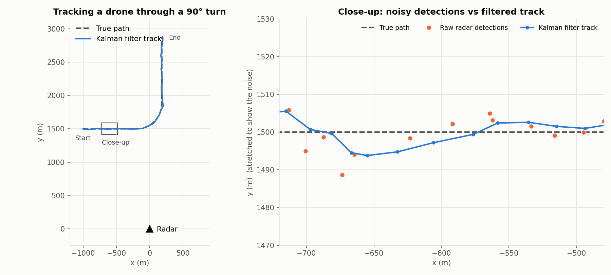
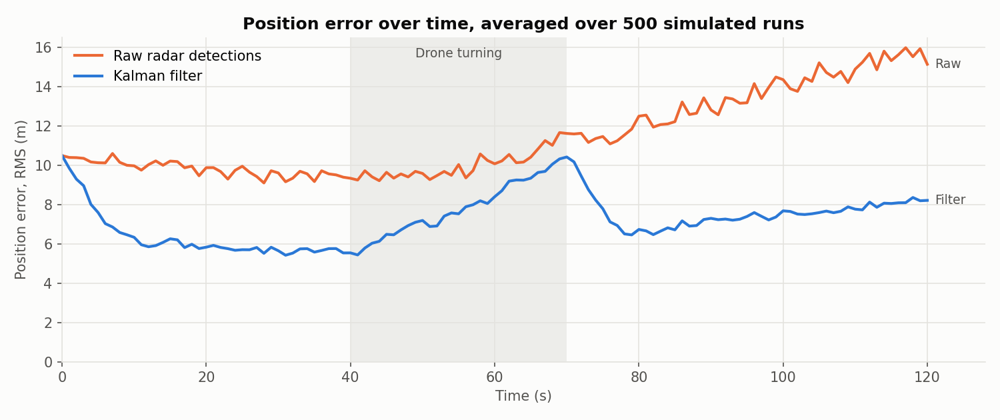
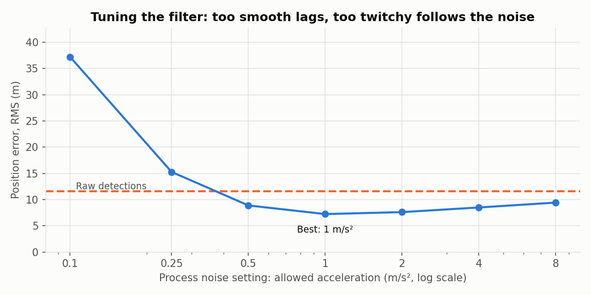

# Radar Target Tracker


**Tracking a simulated drone from noisy radar detections with an extended Kalman filter.**

A surveillance radar doesn't report a clean flight path. Each scan it reports a range and a bearing, both with noise, and sometimes it misses the target altogether. It never measures speed or direction at all. This project simulates that situation and builds a tracker that turns the noisy detections into a smooth, continuous track with a velocity estimate.



## Results

Averaged over 500 simulated flights (the same flight path, with fresh radar noise each time):

| | Raw radar detections | Kalman filter |
|---|---|---|
| Position error (RMS) | 11.6 m | **7.2 m** (38% lower) |
| Velocity error (RMS) | not measured by the radar | **2.3 m/s** |

The filter also keeps the track going through missed detections (10% of scans), where the raw data has nothing.

### Where the error comes from



Two effects show up in this chart:

- **The raw error grows with distance.** A fixed bearing error of 0.3° is about 8 m sideways at 1.5 km but 15 m at 2.9 km, so detections get noisier as the drone flies away.
- **The filter struggles in the turn.** It assumes the target flies in a straight line between scans, so when the drone turns, the prediction lags behind. Its error climbs during the turn, then recovers once the drone is flying straight again. This is the main limitation of a constant-velocity model, and the fix is listed under [next steps](#limitations-and-next-steps).

### Tuning the filter



The one setting that matters most is the **process noise**: how much acceleration the filter allows for between scans.

- **Set too low**, it trusts its own straight-line prediction too much and falls behind in the turn. At 0.1 m/s² it's three times worse than the raw detections.
- **Set too high**, it trusts each noisy detection too much and stops smoothing.
- **1 m/s²** gave the lowest error. That's roughly the acceleration of the drone in its turn (20 m/s at 3°/s ≈ 1.05 m/s²), which is what you'd expect.

## How it works

### The scenario

- A drone flies at 20 m/s: a straight leg, a 90° turn at 3°/s, then another straight leg.
- A radar at the origin scans once per second and reports **range** (±5 m noise) and **bearing** (±0.3° noise).
- Each scan has a 10% chance of missing the drone.

### The tracker

The filter keeps an estimate of the drone's state, `[x, y, vx, vy]`, along with a covariance matrix that says how uncertain that estimate is. Every scan it does two steps:

1. **Predict.** Move the estimate forward one second, assuming constant velocity. Uncertainty grows, because the drone might have changed course.
2. **Update.** If the radar detected the drone, compare what it measured with what the prediction expected. The **Kalman gain** decides how far to move towards the measurement, based on how uncertain each one is. Uncertainty shrinks.

If the radar misses the drone on a scan, the filter just predicts and carries on.

### Details that matter for radar

- **It's an extended Kalman filter.** The radar measures range and bearing, which aren't a linear function of x and y. The EKF linearises the measurement around the current estimate using its Jacobian.
- **Angle wrapping.** Bearings of +179.9° and -179.9° are only 0.2° apart, but a naive subtraction says 359.8°. Without wrapping, a target crossing that line would be thrown across the map. There's a test for exactly this.
- **Starting a track.** The first detection gives a position but no velocity. The starting uncertainty is converted from the radar's range and bearing noise, which makes it an ellipse stretched across the line of sight, because bearing noise matters more than range noise at these distances.
- **Joseph-form covariance update.** It's mathematically the same as the textbook update, but keeps the covariance symmetric and positive definite despite rounding errors. That matters in a tracker that runs for hours.

## Tests

`pytest` checks that:

- the filter is more accurate than the raw detections
- it estimates velocity correctly, even though the radar never measures it
- uncertainty grows when predicting and shrinks when updating
- it coasts through missed detections and knows it's less certain while doing so
- it handles targets crossing the ±180° bearing line (these tests fail if angle wrapping is removed)
- the covariance stays symmetric and positive definite over a long track

The tests run automatically on every push with GitHub Actions.

## Running it

```bash
pip install -r requirements.txt
python run_demo.py          # runs the experiments and saves the charts to docs/
python -m pytest -v         # runs the tests
```

## Project structure

```
tracker/
  simulate.py     drone flight path and simulated radar detections
  ekf.py          the extended Kalman filter
run_demo.py       experiments and charts
tests/            unit tests
docs/             charts and results.json
```

## Limitations and next steps

- **Manoeuvring targets.** A constant-velocity model lags in turns. An **interacting multiple model (IMM)** filter runs a straight-line model and a turning model side by side and blends them, which is the standard fix.
- **Multiple targets and clutter.** Real radars see several targets plus false alarms, so each detection has to be matched to the right track (data association, such as global nearest neighbour or JPDA). That's the next big step.
- **3D.** Adding elevation would track altitude too.
- **Tuning.** The process noise was tuned on the same scenario it's evaluated on. A fairer test would tune on one set of flight paths and evaluate on another.

## Author

Built by [Rohan Sehmbi](https://github.com/Rokuu010).
